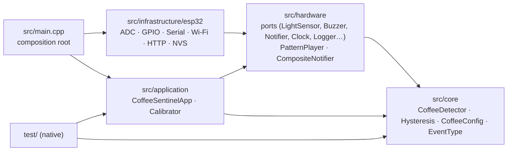
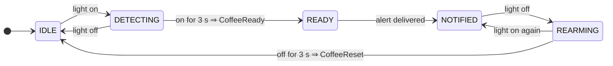

<h1 align="center">☕ Coffee Sentinel</h1>

<p align="center">
  <strong>An ESP32-powered coffee machine watcher that lets the office know when the coffee is ready.</strong>
</p>

<p align="center">
  <a href="https://github.com/Amad3eu/coffeereadyindicator/actions/workflows/ci.yml"></a>
  <a href="https://github.com/Amad3eu/coffeereadyindicator/actions/workflows/ci.yml"></a>
  <a href="https://github.com/Amad3eu/coffeereadyindicator/actions/workflows/docs.yml"></a>
  <a href="LICENSE"></a>
  <a href="https://platformio.org/"></a>
  <a href="https://www.espressif.com/en/products/socs/esp32"></a>
  
</p>

A phototransistor watches the green **READY** LED of the office coffee machine.
When the LED stays on for a few seconds, an ESP32 beeps a buzzer and (optionally)
fires a webhook so Alexa can say *"O café está pronto."* The machine itself is
never opened, modified or wired: the device is completely external and
reversible.

## Demo

<p align="center">
  
</p>

What the serial monitor shows for one coffee:

```
[INFO] Coffee Sentinel 0.1.0 booting
[CONFIG] lightOn>=1800 lightOff<=1200 ready=3000ms rearm=3000ms sample=50ms
[INFO] State: IDLE
[STATE] IDLE -> DETECTING
[STATE] DETECTING -> READY
[EVENT] CoffeeReady
[BUZZER] Playing ready pattern
[NOTIFY] Coffee is ready
[STATE] READY -> NOTIFIED
[STATE] NOTIFIED -> REARMING
[STATE] REARMING -> IDLE
[EVENT] CoffeeReset
```

## How it works

```
Coffee machine
   ↓ green READY LED
Phototransistor (TEPT4400 + 10 kΩ)
   ↓ analog voltage on GPIO34
ESP32
   ├── Buzzer      BEEP · pause · BEEP
   ├── Status LED
   └── Wi-Fi
         ↓
      Webhook (JSON POST)
         ↓
      Home Assistant / your own service
         ↓
       Alexa: "O café está pronto."
```

1. The ESP32 samples the phototransistor every 50 ms.
2. A **hysteresis** comparator decides whether the LED is on (`≥ 1800`) or off (`≤ 1200`), ignoring everything in between, so noise near a threshold cannot flicker.
3. The light must stay on for **3 s** (configurable) before the coffee counts as ready. A LED that blinks while brewing never qualifies.
4. `CoffeeReady` fires **exactly once**: the buzzer plays its pattern, then the notifier is called.
5. Nothing happens again until the LED has been **off for 3 s**, which re-arms the detector for the next brew.
6. A reboot while the LED is already on is treated as "the coffee was ready before I started watching": no stale alert.

## Architecture

Four layers, dependencies pointing one way, no Arduino header above the
infrastructure line. That is what makes the logic testable on a laptop.



| Layer | What lives there | Arduino? |
| --- | --- | :-: |
| `src/core` | Detection rules: state machine, hysteresis, temporal confirmation, re-arm, calibration math, domain events, configuration | no |
| `src/hardware` | Ports (interfaces) for sensor, buzzer, LED, notifier, clock, logger, network, config store; platform-free drivers (`PatternPlayer`, `CompositeNotifier`) | no |
| `src/application` | `CoffeeSentinelApp` (main loop, event routing, logging), `Calibrator`, `AppConfig`, alert patterns | no |
| `src/infrastructure/esp32` | ESP32 adapters: analog sensor, GPIO buzzer/LED, serial logger & notifier, Wi-Fi link, webhook notifier, NVS config store, pin map | yes |
| `src/main.cpp` | Wires everything together; picks normal or calibration mode | yes |

Events are plain values returned by `CoffeeDetector::update()`; the
application is the only dispatcher, so the coffee logic never learns what
HTTP or Alexa are. The reasoning behind each decision is recorded in
[docs/architecture/adr](docs/architecture/adr/README.md), and the full
architecture document (also available as a PDF, see [Documentation](#documentation))
is [docs/architecture.md](docs/architecture.md).

<details>
<summary>Full system diagram</summary>


</details>

## Hardware

| Part | Role |
| --- | --- |
| ESP32 DevKit V1 | Controller, Wi-Fi |
| TEPT4400 phototransistor + 10 kΩ | Sees the machine's green LED (peak sensitivity 570 nm) |
| Active buzzer | Local alert (through an NPN transistor if it draws > 12 mA) |
| Breadboard, jumpers, USB cable, 5 V supply | Prototyping and power |
| *optional* LED + 220 Ω, LiPo + charger, switch, 3D-printed cap | Status LED, battery mode, light shield |

```
3V3 ──┬── C  TEPT4400                 GPIO25 ── (+) buzzer (−) ── GND
      └── E ──┬── GPIO34 (ADC1_CH6)   GPIO2  ── on-board LED
            10 kΩ
              │
             GND
```

GPIO34 is input-only and on ADC1, which keeps working while Wi-Fi is on
(ADC2 does not). Full details: [BOM](docs/hardware/BOM.md) ·
[wiring](docs/hardware/wiring.md) · [battery](docs/hardware/battery.md).

> **Safety.** The coffee machine is never opened and nothing is connected to
> its circuit: the sensor only *looks* at the LED from the outside. The
> project uses 3.3/5 V DC only and will never touch mains voltage. See
> [docs/hardware/safety.md](docs/hardware/safety.md).

## Software

```
src/
├── core/            CoffeeDetector · Hysteresis · CoffeeConfig · CoffeeState · Event · Calibration · LightReading
├── hardware/        LightSensor · Buzzer · StatusLed · DigitalOutput · Notifier · CompositeNotifier · Clock · Logger
│                    NetworkLink · ConfigStore · InMemoryConfigStore · Pattern · PatternPlayer
├── application/     CoffeeSentinelApp · Calibrator · AppConfig · AlertPatterns · Version
├── infrastructure/esp32/
│                    Esp32AnalogLightSensor · Esp32Buzzer · Esp32StatusLed · ArduinoClock · SerialLogger
│                    SerialNotifier · Esp32WiFiLink · WebhookNotifier · NvsConfigStore · BoardPins
└── main.cpp
test/
├── mocks/           MockLightSensor · MockClock · MockBuzzer · MockStatusLed · MockNotifier · MockNetworkLink · MockLogger
├── support/         DetectorDriver · AppHarness · Assertions
└── test_*/          hysteresis · state_machine · application · pattern_player · calibration · config
```

Design rules the code follows: no `delay()` in the control flow, no heap
allocation after boot, no singletons, interfaces with one to three methods,
every tunable number in `CoffeeConfig`/`AppConfig`, C++17, `-Wall -Wextra
-Wpedantic -Werror` on the host build.

## State machine



| State | Buzzer | Status LED |
| --- | --- | --- |
| `IDLE` | silent | off |
| `DETECTING` | silent | fast blink |
| `READY` | BEEP · pause · BEEP | solid |
| `NOTIFIED` | silent | solid |
| `REARMING` | silent | slow heartbeat |

Invalid sensor readings freeze the machine and raise `SensorFailure` once
(three short chirps); valid readings raise `SensorRecovered` and restart the
confirmation window. All timers survive the `millis()` overflow.

## Simulation

The firmware runs unmodified in [Wokwi](https://wokwi.com). A potentiometer
on GPIO34 stands in for the phototransistor, so you can turn the "LED" up
and down by hand and watch the state machine in the serial monitor.

```bash
pio run -e esp32dev                       # build the firmware
# VS Code: install the Wokwi extension, "Wokwi: Select Config File" -> wokwi/wokwi.toml, "Wokwi: Start Simulator"
# CLI:
wokwi-cli wokwi                           # interactive
wokwi-cli wokwi --scenario scenario.yaml  # automated: turns the pot, expects the state transitions
```

Files: [`wokwi/diagram.json`](wokwi/diagram.json), [`wokwi/wokwi.toml`](wokwi/wokwi.toml), [`wokwi/scenario.yaml`](wokwi/scenario.yaml).

## Getting started

```bash
git clone https://github.com/Amad3eu/coffeereadyindicator.git
cd coffeereadyindicator

python3 -m pip install platformio   # or use the PlatformIO IDE extension

pio test -e native                  # run the unit tests on your computer
pio run -e esp32dev                 # compile the firmware
pio run -e esp32dev -t upload       # flash it (board on USB)
pio device monitor -b 115200        # watch the logs
```

Optional Wi-Fi + webhook:

```bash
cp include/secrets.example.h include/secrets.h   # git-ignored
# edit SSID, password and webhook URL, then flash again
```

Without `include/secrets.h` the firmware runs offline: it beeps and logs,
and the Wi-Fi code is not even compiled in.

A `Makefile` wraps the common commands: `make test`, `make build`, `make
upload`, `make monitor`, `make calibrate`, `make format`, `make docs`, `make gif`.

## Testing without hardware

You can develop the whole project before buying a single component.

| What | Command | Needs |
| --- | --- | --- |
| Unit tests of core, hardware ports and application | `pio test -e native` | a C++17 host compiler |
| Same tests under AddressSanitizer + UBSan | `pio test -e native-sanitize` | GCC or Clang |
| Line coverage gate (100 % of the platform-independent layers) | `scripts/coverage.sh` | gcovr |
| Static analysis | `pio check -e native` | nothing else (cppcheck is fetched by PlatformIO) |
| Full firmware in a browser/VS Code with a virtual sensor | Wokwi (see [Simulation](#simulation)) | free Wokwi license |
| Compile the real firmware | `pio run -e esp32dev` | nothing else |
| Serial monitor on real hardware | `pio device monitor -b 115200` | an ESP32 |

The tests cover the fifteen scenarios that matter: light never on, short
flash, sustained light, exactly one `CoffeeReady`, LED on for 20 minutes
without a second alert, light off, re-arm, second coffee, values oscillating
around the thresholds, invalid sensor values, `millis()` overflow and
reboots in every state. Mocks exist for the sensor, clock, buzzer, LED,
notifier, network link and logger. Details in [docs/testing.md](docs/testing.md).

```bash
pio test -e native -f test_state_machine       # one suite
COFFEE_TEST_VERBOSE=1 pio test -e native       # echo captured log lines
```

## Configuration

All tunables live in two structs; there are no magic numbers in the logic.

```cpp
struct CoffeeConfig {                      // src/core/CoffeeConfig.h
    uint16_t lightOnThreshold = 1800;      // reading >= this  -> light on
    uint16_t lightOffThreshold = 1200;     // reading <= this  -> light off (hysteresis)
    uint32_t readyConfirmationMs = 3000;   // light must stay on this long
    uint32_t rearmConfirmationMs = 3000;   // light must stay off this long
    uint16_t sensorMaxValue = 4095;        // 12-bit ADC; above = invalid reading
    bool alertIfLightOnAtBoot = false;     // see ADR 0004
};

struct AppConfig {                         // src/application/AppConfig.h
    CoffeeConfig detection;
    uint32_t sampleIntervalMs = 50;
    uint32_t sensorLogIntervalMs = 5000;   // DEBUG level only
    bool notifyOnReset = false;
};
```

Pins are in [`src/infrastructure/esp32/BoardPins.h`](src/infrastructure/esp32/BoardPins.h)
(sensor GPIO34, buzzer GPIO25, LED GPIO2). Stored settings are read from NVS
at boot through `NvsConfigStore`; saving from the serial console is on the
roadmap.

### Calibration

```bash
make calibrate        # = pio run -e esp32dev-calibration -t upload && pio device monitor
```

Three phases (ambient, LED off, LED on), each confirmed with Enter in the
serial monitor:

```
[CALIBRATION] Ambient: 322
[CALIBRATION] LED OFF: 341
[CALIBRATION] LED ON: 2870
[CALIBRATION] Suggested thresholds: lightOnThreshold=1858 lightOffThreshold=1099
```

See [docs/calibration.md](docs/calibration.md).

### Logging

Four levels (`DEBUG`, `INFO`, `WARN`, `ERROR`; `kLogLevel` in `main.cpp`).
Lines are `[TAG] message`, with `[WARN]`/`[ERROR]` prefixed:
`[WARN][SENSOR] Invalid readings; detection paused`. Sensor samples are
logged only at `DEBUG`, so production output stays quiet.

## Alexa integration

The ESP32 POSTs

```json
{"event":"coffee_ready","message":"Coffee is ready","device":"coffee-sentinel","version":"0.1.0"}
```

to the webhook URL from `secrets.h`. A Home Assistant automation with a
`webhook` trigger and the Alexa Media Player integration turns it into an
announcement; the YAML is in
[docs/alexa-integration.md](docs/alexa-integration.md), together with
alternatives (Virtual Smart Home, IFTTT, your own endpoint).

## Battery mode

v0.1 runs from USB. The planned evolution (LiPo + charger/protection module
or a board with built-in charging), measured consumption figures, the
impact of Wi-Fi and the light/deep-sleep strategies are documented in
[docs/hardware/battery.md](docs/hardware/battery.md). The ports already
isolate the policies that change (lazy Wi-Fi, sampling interval, boot
behaviour), so this lands without touching the detection logic.

## Documentation

| Document | Content |
| --- | --- |
| [docs/architecture.md](docs/architecture.md) | Overview, layers, hardware flow, state machine, BOM, operation, safety, roadmap. Source of the PDF |
| [docs/architecture/adr](docs/architecture/adr/README.md) | Why things are the way they are |
| [docs/hardware](docs/hardware) | [BOM](docs/hardware/BOM.md), [wiring](docs/hardware/wiring.md), [safety](docs/hardware/safety.md), [battery](docs/hardware/battery.md) |
| [docs/diagrams](docs/diagrams) | Mermaid sources; rendered SVGs in [docs/images/diagrams](docs/images/diagrams) |
| [docs/testing.md](docs/testing.md) · [docs/calibration.md](docs/calibration.md) · [docs/alexa-integration.md](docs/alexa-integration.md) · [docs/roadmap.md](docs/roadmap.md) | Guides |

Generate the PDF (`docs/generated/coffee-sentinel-architecture.pdf`) and the README GIF:

```bash
make docs    # python3 scripts/build_docs.py  — needs pandoc + xelatex + Mermaid CLI, or just Docker (--renderer docker --pandoc docker)
make gif     # python3 scripts/generate_demo_gif.py — needs Pillow
```

## Roadmap

| Version | Scope |
| --- | --- |
| **v0.1** | Light detection, state machine, buzzer, native tests, Wokwi, CI *(this release)* |
| **v0.2** | Wi-Fi link and webhook notifier *(already compiled in when `secrets.h` exists)*, webhook retry, NVS save from the console, mDNS |
| **v0.3** | Alexa / Home Assistant integration, MQTT discovery |
| **v0.4** | Battery monitoring, lazy Wi-Fi, light/deep sleep |
| **v0.5** | OTA updates, remote configuration |
| later | OLED display, battery percentage, MQTT, several machines, web dashboard, statistics (brewing time, coffees per day), 3D-printed case, automatic calibration |

Full list: [docs/roadmap.md](docs/roadmap.md).

## Contributing

Issues and pull requests are welcome. Read [CONTRIBUTING.md](CONTRIBUTING.md)
for the layering rules, the test expectations and the commit convention,
and [CODE_OF_CONDUCT.md](CODE_OF_CONDUCT.md) for how we treat each other.
Quick checklist before a PR:

```bash
make test          # pio test -e native
make test-sanitize # pio test -e native-sanitize
make coverage      # scripts/coverage.sh --html
make check         # pio check -e native (cppcheck)
make build         # pio run -e esp32dev
make check-format  # clang-format
```

## License

[MIT](LICENSE) © 2026 Luiz Amadeu (Amad3eu) and the Coffee Sentinel contributors.
