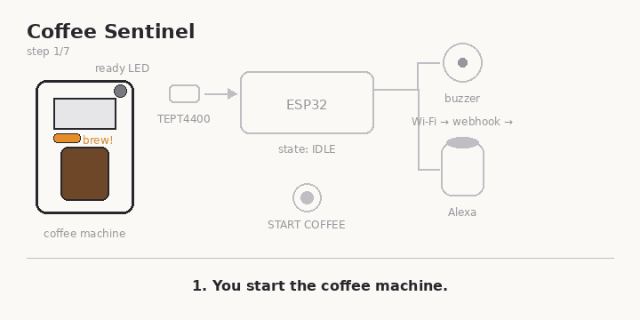
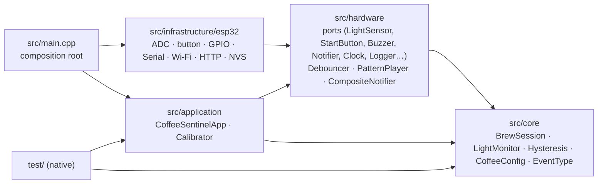
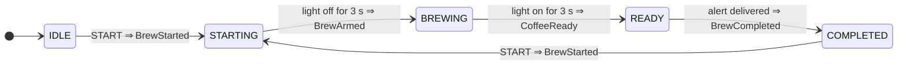

<h1 align="center">☕ Coffee Ready Indicator</h1>

<p align="center">
  <strong>An ESP32-powered coffee machine watcher that lets the office know when the coffee is ready.</strong><br>
  <sub>Firmware and device name: <em>Coffee Sentinel</em></sub>
</p>

<p align="center">
  <a href="https://github.com/Amad3eu/coffeereadyindicator/actions/workflows/ci.yml"></a>
  <a href="https://github.com/Amad3eu/coffeereadyindicator/actions/workflows/ci.yml"></a>
  <a href="https://github.com/Amad3eu/coffeereadyindicator/actions/workflows/docs.yml"></a>
  <a href="LICENSE"></a>
  <a href="https://platformio.org/"></a>
  <a href="https://www.espressif.com/en/products/socs/esp32"></a>
  
</p>

**What it is.** A small box next to the office coffee machine: an ESP32, a
phototransistor taped over the machine's green **READY** LED, a START COFFEE
button, a buzzer. **Why it exists.** The machine is far from the desks and
nobody notices when the coffee is done; the machine cannot be modified, so
the only signal available is its light. **How it works.** You press
START COFFEE when you start a brew; once the machine has left its green
state and the LED later comes back green and stays green, the device beeps
and (optionally) fires a webhook so Alexa can say *"O café está pronto."*
The machine itself is never opened, modified or wired: the device is
completely external and reversible.

> **Status: v0.1 software complete and tested; physical validation pending.**
> See [Real Hardware Validation](#real-hardware-validation).

> **Coffee Sentinel does not treat every green light as coffee ready. A brew
> cycle must first be started using the device button.** Real machines flash
> green while processing and stay green after a brew; only a green light
> inside a session you started counts, and each session alerts exactly once.

## Demo

<p align="center">
  
</p>

What the serial monitor shows for one coffee:

```
[INFO] Coffee Sentinel 0.1.0 booting
[CONFIG] lightOn>=1800 lightOff<=1200 cycleStart=3000ms ready=3000ms sample=50ms debounce=50ms
[INFO] State: IDLE
[INFO] Press START to begin a brew cycle
[BUTTON] START pressed
[STATE] IDLE -> STARTING
[EVENT] BrewStarted
[STATE] STARTING -> BREWING
[EVENT] BrewArmed
[STATE] BREWING -> READY
[EVENT] CoffeeReady
[BUZZER] Playing ready pattern
[NOTIFY] Coffee is ready
[STATE] READY -> COMPLETED
[EVENT] BrewCompleted
```

## How it works

```
You start the coffee machine            You press START COFFEE on the device
            │                                          │
            ▼                                          ▼
Coffee machine READY LED                       Brew session opens
   ↓ light (green / red / off)                 (the current light is ignored)
Phototransistor (TEPT4400 + 10 kΩ)                     │
   ↓ analog voltage on GPIO34                          │
ESP32  ◄───────────────────────────────────────────────┘
   ├── waits for the light to be OFF for 3 s   (the cycle really started)
   ├── then waits for the light to be ON for 3 s (the ready light)
   ├── Buzzer      BEEP · pause · BEEP
   ├── Status LED
   └── Wi-Fi → Webhook (JSON POST) → Home Assistant → Alexa: "O café está pronto."
```

1. **Nothing happens without START.** A green LED while no session is open (machine idle, previous coffee still shown) is ignored.
2. **START opens a session** (`IDLE → STARTING`). The current light is ignored on purpose: pressing START while the machine is already green must not alert.
3. **The session arms once the machine has left the green state**: the light has to stay off (dark or red) for `cycleStartConfirmationMs` (3 s). A green flash during that wait restarts the wait (`STARTING → BREWING`).
4. The ESP32 samples the phototransistor every 50 ms; a **hysteresis** comparator decides on (`≥ 1800`) / off (`≤ 1200`) so noise near a threshold cannot flicker.
5. **Armed, a green that stays on for `readyConfirmationMs`** (3 s) means coffee: `CoffeeReady` fires **exactly once**, the buzzer plays, then the notifier is called (`BREWING → READY → COMPLETED`).
6. **After COMPLETED the light is ignored** until the next START. A START during an active session is ignored and logged. A reboot returns to IDLE and needs a new START.

## Architecture

Four layers, dependencies pointing one way, no Arduino header above the
infrastructure line. That is what makes the logic testable on a laptop.



```
StartButton ──▶ Debouncer ──▶ CoffeeSentinelApp ──▶ BrewSession ◀── LightMonitor ◀── LightSensor
                                     │
                                     ├── Buzzer (PatternPlayer)
                                     ├── StatusLed (PatternPlayer)
                                     └── Notifier (serial, webhook)
```

| Layer | What lives there | Arduino? |
| --- | --- | :-: |
| `src/core` | `BrewSession` (the session state machine and arming rule), `LightMonitor` (hysteresis, sensor health), temporal confirmation, calibration math, domain events, configuration | no |
| `src/hardware` | Ports (interfaces) for sensor, START button, buzzer, LED, notifier, clock, logger, network, config store; platform-free drivers (`Debouncer`, `PatternPlayer`, `CompositeNotifier`) | no |
| `src/application` | `CoffeeSentinelApp` (button → session wiring, sampling, event routing, logging), `Calibrator`, `AppConfig`, alert patterns | no |
| `src/infrastructure/esp32` | ESP32 adapters: analog sensor, GPIO button/buzzer/LED, serial logger & notifier, Wi-Fi link, webhook notifier, NVS config store, pin map | yes |
| `src/main.cpp` | Wires everything together; picks normal or calibration mode | yes |

Events are plain values returned by `BrewSession` and `LightMonitor`; the
application is the only dispatcher, so the coffee logic never learns what
buttons, HTTP or Alexa are. The reasoning behind each decision is recorded in
[docs/architecture/adr](docs/architecture/adr/README.md), and the full
architecture document (also available as a PDF, see [Documentation](#documentation))
is [docs/architecture.md](docs/architecture.md).

<details>
<summary>Full system diagram</summary>



</details>

## Hardware

| Part | Role |
| --- | --- |
| ESP32 DevKit V1 | Controller, Wi-Fi |
| TEPT4400 phototransistor + 10 kΩ | Sees the machine's green LED (peak sensitivity 570 nm) |
| Momentary push button | START COFFEE (GPIO33 to GND, internal pull-up, no resistor) |
| Active buzzer | Local alert (through an NPN transistor if it draws > 12 mA) |
| Breadboard, jumpers, USB cable, 5 V supply | Prototyping and power |
| *optional* LED + 220 Ω, LiPo + charger, switch, 3D-printed cap | Status LED, battery mode, light shield |

```
3V3 ──┬── C  TEPT4400                 GPIO33 ── START button ── GND   (INPUT_PULLUP)
      └── E ──┬── GPIO34 (ADC1_CH6)   GPIO25 ── (+) buzzer (−) ── GND
            10 kΩ                      GPIO2  ── on-board LED
              │
             GND
```

GPIO34 is input-only and on ADC1, which keeps working while Wi-Fi is on
(ADC2 does not). GPIO33 is not a strapping pin, has an internal pull-up and
can wake the chip from deep sleep later. Full details: [BOM](docs/hardware/BOM.md) ·
[wiring](docs/hardware/wiring.md) · [battery](docs/hardware/battery.md).

> **Safety.** The coffee machine is never opened and nothing is connected to
> its circuit: the sensor only *looks* at the LED from the outside. The
> project uses 3.3/5 V DC only and will never touch mains voltage. See
> [docs/hardware/safety.md](docs/hardware/safety.md).

## Software

```
src/
├── core/            BrewSession · BrewState · LightMonitor · Hysteresis · CoffeeConfig · Event · Calibration · LightReading
├── hardware/        LightSensor · StartButton · Debouncer · Buzzer · StatusLed · DigitalOutput · Notifier · CompositeNotifier
│                    Clock · Logger · NetworkLink · ConfigStore · InMemoryConfigStore · Pattern · PatternPlayer
├── application/     CoffeeSentinelApp · Calibrator · AppConfig · AlertPatterns · Version
├── infrastructure/esp32/
│                    Esp32AnalogLightSensor · Esp32StartButton · Esp32Buzzer · Esp32StatusLed · ArduinoClock · SerialLogger
│                    SerialNotifier · Esp32WiFiLink · WebhookNotifier · NvsConfigStore · BoardPins
└── main.cpp
test/
├── mocks/           MockLightSensor · MockStartButton · MockClock · MockBuzzer · MockStatusLed · MockNotifier · MockNetworkLink · MockLogger
├── support/         SessionDriver · AppHarness · Assertions
└── test_*/          brew_session · light_monitor · debouncer · hysteresis · application · pattern_player · calibration · config · enum_strings
```

Design rules the code follows: no `delay()` in the control flow, no heap
allocation after boot, no singletons, interfaces with one to three methods,
every tunable number in `CoffeeConfig`/`AppConfig`, C++17, `-Wall -Wextra
-Wpedantic -Werror` on the host build.

## State machine



| State | Meaning | Light | Buzzer | Status LED |
| --- | --- | --- | --- | --- |
| `IDLE` | no session | ignored | silent | off |
| `STARTING` | START pressed; waiting for the machine to leave its green state | must be off for 3 s (a green restarts the wait) | one short blip on START | fast blink |
| `BREWING` | armed | must be on for 3 s | silent | slow heartbeat |
| `READY` | coffee confirmed, alert playing | ignored | BEEP · pause · BEEP | solid |
| `COMPLETED` | alert delivered; waiting for the next START | ignored | silent | solid |

A START while a session is active is ignored and logged (`StartIgnored`),
never restarted silently. Invalid sensor readings freeze the session and
raise `SensorFailure` once (three short chirps); valid readings raise
`SensorRecovered` and restart the confirmation window in progress, so no
alert is ever based on an observation with a gap. All timers survive the
`millis()` overflow. Why it works this way: [ADR 0006](docs/architecture/adr/0006-brew-session.md).

## Simulation

The firmware runs unmodified in [Wokwi](https://wokwi.com). A potentiometer
on GPIO34 stands in for the phototransistor and a push button on GPIO33 is
START COFFEE, so you can press START, turn the "LED" up and down by hand and
watch the session in the serial monitor. Three scripted checks (START while
already green, a too-short green, oscillations after COMPLETED) are in
[docs/testing.md](docs/testing.md#2-wokwi-simulation).

```bash
pio run -e esp32dev                       # build the firmware
# VS Code: install the Wokwi extension, "Wokwi: Select Config File" -> wokwi/wokwi.toml, "Wokwi: Start Simulator"
# CLI:
wokwi-cli wokwi                           # interactive
wokwi-cli wokwi --scenario scenario.yaml  # automated: presses START, drives the pot, expects the transitions
```

Files: [`wokwi/diagram.json`](wokwi/diagram.json), [`wokwi/wokwi.toml`](wokwi/wokwi.toml), [`wokwi/scenario.yaml`](wokwi/scenario.yaml).

## Getting started

```bash
git clone https://github.com/Amad3eu/coffeereadyindicator.git
cd coffeereadyindicator

python3 -m pip install platformio   # or use the PlatformIO IDE extension

pio test -e native                  # run the unit tests on your computer
pio run -e esp32dev                 # compile the firmware
pio run -e esp32dev -t upload       # flash it (board on USB)
pio device monitor -b 115200        # watch the logs
```

Optional Wi-Fi + webhook:

```bash
cp include/secrets.example.h include/secrets.h   # git-ignored
# edit SSID, password and webhook URL, then flash again
```

Without `include/secrets.h` the firmware runs offline: it beeps and logs,
and the Wi-Fi code is not even compiled in.

A `Makefile` wraps the common commands: `make test`, `make build`, `make
upload`, `make monitor`, `make calibrate`, `make format`, `make docs`, `make gif`.

## Testing without hardware

You can develop the whole project before buying a single component.

| What | Command | Needs |
| --- | --- | --- |
| Unit tests of core, hardware ports and application | `pio test -e native` | a C++17 host compiler |
| Same tests under AddressSanitizer + UBSan | `pio test -e native-sanitize` | GCC or Clang |
| Line coverage gate (100 % of the platform-independent layers) | `scripts/coverage.sh` | gcovr |
| Static analysis | `pio check -e native` | nothing else (cppcheck is fetched by PlatformIO) |
| Full firmware in a browser/VS Code with a virtual sensor | Wokwi (see [Simulation](#simulation)) | free Wokwi license |
| Compile the real firmware | `pio run -e esp32dev` | nothing else |
| Serial monitor on real hardware | `pio device monitor -b 115200` | an ESP32 |

The tests cover the scenarios that matter: a green before START never
alerts, START with the light already green never alerts, a session needs a
confirmed cycle start, a too-short green is ignored, one `CoffeeReady` per
session, oscillations after COMPLETED are ignored, a new START allows a new
cycle, a duplicate START is ignored, button debouncing, invalid sensor
values and recovery mid-cycle, `millis()` overflow and reboots in every
state. Mocks exist for the sensor, button, clock, buzzer, LED, notifier,
network link and logger. Details in [docs/testing.md](docs/testing.md); the
manual Wokwi walk-through is in
[docs/testing/wokwi-manual-test.md](docs/testing/wokwi-manual-test.md).

In CI the automated Wokwi scenario runs **only when the `WOKWI_CLI_TOKEN`
secret is configured**; otherwise the *Wokwi simulation* job is skipped and
reported as such, never shown as green
([docs/testing/wokwi-ci.md](docs/testing/wokwi-ci.md)).

```bash
pio test -e native -f test_brew_session        # one suite
COFFEE_TEST_VERBOSE=1 pio test -e native       # echo captured log lines
```

## Configuration

All tunables live in two structs; there are no magic numbers in the logic.

```cpp
struct CoffeeConfig {                          // src/core/CoffeeConfig.h
    uint16_t lightOnThreshold = 1800;          // reading >= this  -> light on (green)
    uint16_t lightOffThreshold = 1200;         // reading <= this  -> light off (hysteresis)
    uint32_t cycleStartConfirmationMs = 3000;  // after START: light must stay off this long to arm
    uint32_t readyConfirmationMs = 3000;       // armed: light must stay on this long to alert
    uint16_t sensorMaxValue = 4095;            // 12-bit ADC; above = invalid reading
};

struct AppConfig {                             // src/application/AppConfig.h
    CoffeeConfig detection;
    uint32_t sampleIntervalMs = 50;
    uint32_t sensorLogIntervalMs = 5000;       // DEBUG level only
    uint32_t buttonDebounceMs = 50;            // START button settling time
};
```

Pins are in [`src/infrastructure/esp32/BoardPins.h`](src/infrastructure/esp32/BoardPins.h)
(sensor GPIO34, START button GPIO33, buzzer GPIO25, LED GPIO2). Stored settings are read from NVS
at boot through `NvsConfigStore`; saving from the serial console is on the
roadmap.

`readyConfirmationMs` deserves a note: it is the one number that depends on
how *your* machine behaves. Default `3000` ms; change the default in
`CoffeeConfig` (or the value in NVS); unit milliseconds; it sets how long the
green must hold, while armed, before the alert, and therefore the delay
between the ready light and the beep. After changing it, run the native
tests, scenario B of the manual Wokwi test, and one real brew. Why it may
need to change: [docs/hardware/transient-greens.md](docs/hardware/transient-greens.md).

### Calibration

```bash
make calibrate        # = pio run -e esp32dev-calibration -t upload && pio device monitor
```

Three phases (ambient, machine not green — off or red —, LED green), each
confirmed with Enter in the serial monitor:

```
[CALIBRATION] Ambient: 322
[CALIBRATION] LED OFF: 341
[CALIBRATION] LED ON: 2870
[CALIBRATION] Suggested thresholds: lightOnThreshold=1858 lightOffThreshold=1099
```

See [docs/calibration.md](docs/calibration.md).

### Logging

Four levels (`DEBUG`, `INFO`, `WARN`, `ERROR`; `kLogLevel` in `main.cpp`).
Lines are `[TAG] message`, with `[WARN]`/`[ERROR]` prefixed:
`[WARN][SENSOR] Invalid readings; detection paused`. Sensor samples are
logged only at `DEBUG`, so production output stays quiet.

## Alexa integration

The ESP32 POSTs

```json
{"event":"coffee_ready","message":"Coffee is ready","device":"coffee-sentinel","version":"0.1.0"}
```

to the webhook URL from `secrets.h`. The same events will feed the internal
Coffee Ready Server planned for v0.2 ([roadmap](docs/roadmap.md)); the
device only ever publishes events. A Home Assistant automation with a
`webhook` trigger and the Alexa Media Player integration turns it into an
announcement; the YAML is in
[docs/alexa-integration.md](docs/alexa-integration.md), together with
alternatives (Virtual Smart Home, IFTTT, your own endpoint).

## Battery mode

v0.1 runs from USB. The planned evolution (LiPo + charger/protection module
or a board with built-in charging), measured consumption figures, the
impact of Wi-Fi and the light/deep-sleep strategies are documented in
[docs/hardware/battery.md](docs/hardware/battery.md); it comes after the
web platform in the [roadmap](docs/roadmap.md). The ports already
isolate the policies that change (lazy Wi-Fi, sampling interval, boot
behaviour), so this lands without touching the detection logic.

## Real Hardware Validation

The software is complete and tested (native tests, sanitizers, 100 % line
coverage of the logic, Wokwi scenarios), but the device has **not** been
validated on a real coffee machine yet. These values still have to be
measured on the machine before v0.1 can be called done:

- **Real ADC levels** of the phototransistor at the mounting spot (ambient,
  machine off, red, green), and whether the 10 kΩ load gives a usable span.
- **Red versus green separation**: with one phototransistor the thresholds
  must sit between the red and the green readings; the calibration measures
  the OFF reference in the non-green state for exactly this reason.
- **Ambient light**: office lighting, sunlight, flashes and shadows must not
  push the reading over `lightOnThreshold` (light shield if they do).
- **Transient greens**: the machine may show green before the coffee is
  ready. Every such green must be shorter than `readyConfirmationMs`
  ([docs/hardware/transient-greens.md](docs/hardware/transient-greens.md)).
- **`readyConfirmationMs`**: 3000 ms is the starting value, not a validated one.

The procedure is [docs/hardware/bring-up.md](docs/hardware/bring-up.md); the
status of the release is tracked in
[docs/releases/v0.1-checklist.md](docs/releases/v0.1-checklist.md).

## Limitations

- One phototransistor cannot see colours; "green" is "bright enough", which
  the calibration makes true by measuring red as the OFF reference. A machine
  whose red is brighter than its green needs the RGB / two-sensor evolution
  from the roadmap.
- A START pressed by mistake leaves the session waiting; cancelling needs a
  reset until a long-press/timeout lands (roadmap).
- Session state lives in RAM: a reboot mid-brew loses the session.
- The webhook is sent once, without retry (roadmap).
- USB power only in v0.1; battery operation is a later step.

## Documentation

| Document | Content |
| --- | --- |
| [docs/architecture.md](docs/architecture.md) | Overview, layers, hardware flow, state machine, BOM, operation, safety, roadmap. Source of the PDF |
| [docs/architecture/adr](docs/architecture/adr/README.md) | Why things are the way they are |
| [docs/hardware](docs/hardware) | [BOM](docs/hardware/BOM.md), [wiring](docs/hardware/wiring.md), [safety](docs/hardware/safety.md), [bring-up checklist](docs/hardware/bring-up.md), [transient greens](docs/hardware/transient-greens.md), [battery](docs/hardware/battery.md) |
| [docs/diagrams](docs/diagrams) | Mermaid sources; rendered SVGs in [docs/images/diagrams](docs/images/diagrams) |
| [docs/testing.md](docs/testing.md) · [docs/testing/wokwi-manual-test.md](docs/testing/wokwi-manual-test.md) · [docs/testing/wokwi-ci.md](docs/testing/wokwi-ci.md) · [docs/calibration.md](docs/calibration.md) · [docs/alexa-integration.md](docs/alexa-integration.md) · [docs/roadmap.md](docs/roadmap.md) | Guides |
| [docs/releases/v0.1-checklist.md](docs/releases/v0.1-checklist.md) | What is done and what is pending for v0.1 |

Generate the PDF (`docs/generated/coffee-sentinel-architecture.pdf`) and the README GIF:

```bash
make docs    # python3 scripts/build_docs.py  — needs pandoc + xelatex + Mermaid CLI, or just Docker (--renderer docker --pandoc docker)
make gif     # python3 scripts/generate_demo_gif.py — needs Pillow
```

## Roadmap

| Version | Scope |
| --- | --- |
| **v0.1** | Firmware + real hardware validation: brew sessions with the START button, light detection, buzzer, native tests, Wokwi, CI *(software complete; physical validation pending)* |
| **v0.2** | Coffee Ready Server: API, persistence, ingestion of the device events (`device_online`, `brew_started`, `brew_armed`, `coffee_ready`, `brew_completed`, `sensor_failure`, `sensor_recovered`) |
| **v0.3** | Internal web dashboard (`http://coffee.local`): live status, current brew, daily history |
| **v0.4** | Real-time updates (SSE) and browser notifications |
| **v0.5** | Chrome / Firefox WebExtension |
| later | Analytics, several machines, PWA, Alexa / Home Assistant through the server; on the device: battery and sleep, OTA, OLED, RGB / two-sensor colour detection, session timeout and cancel |

Full list: [docs/roadmap.md](docs/roadmap.md).

## Contributing

Issues and pull requests are welcome. Read [CONTRIBUTING.md](CONTRIBUTING.md)
for the layering rules, the test expectations and the commit convention,
and [CODE_OF_CONDUCT.md](CODE_OF_CONDUCT.md) for how we treat each other.
Quick checklist before a PR:

```bash
make test          # pio test -e native
make test-sanitize # pio test -e native-sanitize
make coverage      # scripts/coverage.sh --html
make check         # pio check -e native (cppcheck)
make build         # pio run -e esp32dev
make check-format  # clang-format
```

## License

[MIT](LICENSE) © 2026 Luiz Amadeu (Amad3eu).
