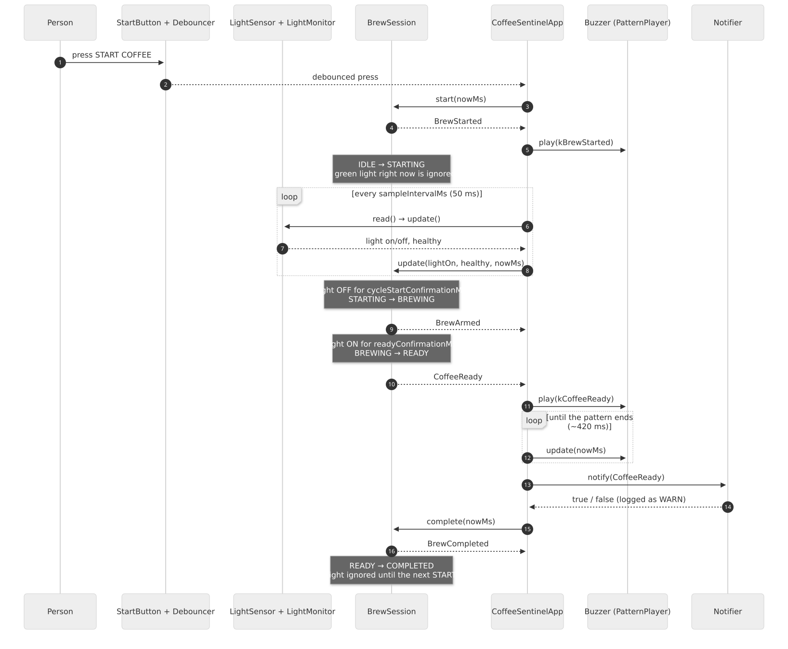

# Overview

Coffee Sentinel is a small, fully external device that watches the green
READY LED of an office coffee machine and announces when the coffee is
done: first with a local buzzer, then (optionally) with a Wi-Fi webhook that
a home-automation hub turns into an Alexa announcement.

A green light alone is not enough: the real machine flashes green while it
processes and keeps the LED green after a brew. Coffee Sentinel therefore
works in **brew sessions**. The person who starts the coffee presses the
device's START COFFEE button; the session waits until the machine has left
its green state, and only then does the next steady green count as "ready",
exactly once.

The machine is never opened, modified or wired. A phototransistor simply
looks at the LED.

```
Person starts the machine         Person presses START COFFEE
          |                                  |
          v                                  v
Coffee machine READY LED              brew session opens
   | light (green / red / off)        (current light ignored)
   v                                         |
Phototransistor (TEPT4400 + 10 kOhm)         |
   | analog voltage                          |
   v                                         |
ESP32 DevKit V1  <---------------------------+
   +-- light OFF for 3 s  -> armed (the cycle really started)
   +-- light ON for 3 s   -> coffee ready, once per session
   +-- Buzzer      BEEP . pause . BEEP
   +-- Status LED
   +-- Wi-Fi -> HTTP webhook -> Home Assistant -> Alexa: "O cafe esta pronto."
```

## Goals

* **Reliable "once per coffee" detection.** No alert without a deliberate
  START, no alert from the green the machine already shows when START is
  pressed, no repeated alerts while the LED stays on, no false alerts from
  flicker, reflections or a blinking LED.
* **Testable without hardware.** Every decision the device takes is plain
  C++ that runs on a desktop under `pio test -e native`.
* **Grow without rewrites.** Wi-Fi, battery, MQTT and a display are planned;
  the layering keeps them as additions, not modifications.
* **Simple.** A handful of small classes, no heap allocations in the control
  loop, no blocking delays, no framework beyond Arduino-ESP32.

## Non-goals

* Controlling the machine (no relay, no mains).
* Running on anything but a single device per machine (for now).

# Architecture

## Layers



| Layer | Directory | Depends on | Contents |
|------------|------------------------|-----------------|------------------------------|
| Core | `src/core` | `<cstdint>` | `BrewSession` (session state machine), `LightMonitor` (hysteresis + sensor health), `Hysteresis`, `CoffeeConfig`, `BrewState`, `EventType`, `LightReading`, calibration math |
| Hardware ports | `src/hardware` | core | Interfaces `LightSensor`, `StartButton`, `Buzzer`, `StatusLed`, `Notifier`, `Clock`, `Logger`, `NetworkLink`, `ConfigStore`; platform-free drivers `Debouncer`, `PatternPlayer`, `CompositeNotifier`, `InMemoryConfigStore` |
| Application | `src/application` | core, hardware | `CoffeeSentinelApp` (button, sampling, event routing), `Calibrator`, `AppConfig`, `AlertPatterns` |
| Infrastructure | `src/infrastructure/esp32` | hardware, Arduino | `Esp32AnalogLightSensor`, `Esp32StartButton`, `Esp32Buzzer`, `Esp32StatusLed`, `ArduinoClock`, `SerialLogger`, `SerialNotifier`, `Esp32WiFiLink`, `WebhookNotifier`, `NvsConfigStore`, `BoardPins` |
| Composition root | `src/main.cpp` | everything | Instantiates the adapters and the application; chooses normal or calibration mode |

Dependencies only point downwards. The `native` PlatformIO environment
compiles the first three layers and the tests; nothing in them includes an
Arduino header.

## Components


**`LightMonitor`** receives one `LightReading` per sample and keeps a
debounced light state (`isOn()`, through the `Hysteresis`) plus sensor
health (`isHealthy()`). It returns `SensorFailure` / `SensorRecovered` on
health transitions. It knows nothing about coffee or hardware.

**`BrewSession`** is the session state machine described below. `start()`
is called on a debounced button press and returns `BrewStarted` or
`StartIgnored`; `update(lightOn, healthy, now)` returns `BrewArmed`,
`CoffeeReady` or nothing; `complete()` closes a `READY` session with
`BrewCompleted`.

**`Debouncer`** turns the raw button level (`StartButton` port) into one
press event per debounced falling edge, without blocking. A button held at
boot is not a press.

**`CoffeeSentinelApp`** runs the loop: on every iteration it polls the
button; every `sampleIntervalMs` it reads the sensor, feeds the monitor and
the session, logs state transitions and routes events:

* `BrewStarted` → short confirmation blip on the buzzer.
* `BrewArmed` → log only.
* `CoffeeReady` → start the ready pattern; when the pattern ends, call the
  `Notifier` once and close the session (`complete()` → `BrewCompleted`).
* `StartIgnored` → warning log naming the active state; nothing restarts.
* `SensorFailure` → warning log and a distinctive chirp; `SensorRecovered` → log.
* Network link up/down → `WiFiConnected` / `WiFiDisconnected` events.

**`PatternPlayer`** plays an on/off `Pattern` on any `DigitalOutput` without
blocking. The buzzer and the status LED each have one; patterns live in
`AlertPatterns.h` (START blip, ready beep, sensor-failure chirp, blink
styles per state).

**`Notifier`** implementations: `SerialNotifier` (always on),
`WebhookNotifier` (JSON POST, compiled in when `include/secrets.h` exists),
`CompositeNotifier` (fan-out to both).

**`Logger`** formats `[TAG] message` lines with DEBUG/INFO/WARN/ERROR levels;
`SerialLogger` writes them to the UART, `MockLogger` captures them in tests.

**`ConfigStore`** persists `CoffeeConfig`: `NvsConfigStore` on the ESP32
(Preferences/NVS), `InMemoryConfigStore` in tests. The firmware loads
stored settings at boot and falls back to the defaults if none are valid.

## One coffee, end to end



# Hardware flow



The TEPT4400 is wired as an emitter follower: collector to 3.3 V, emitter to
GPIO34 and to a 10 kΩ resistor to ground. More light means more collector
current and a higher voltage on the ADC (0–4095 at 12 bits). GPIO34 is on
ADC1, which stays usable while Wi-Fi is active.

The START COFFEE button is a momentary switch between GPIO33 and GND; the
firmware enables the internal pull-up, so no resistor is needed. GPIO33 is
not a strapping pin and, being an RTC GPIO, can wake the chip from deep
sleep later. The buzzer is an active type on GPIO25 (through an NPN
transistor if it draws more than ~12 mA). The status LED is the DevKit's
on-board LED on GPIO2. Details, pin rationale and alternatives are in
`docs/hardware/wiring.md`.

# State machine



| State | Meaning | Leaves when |
|---------|------------------|-----------------------------------------|
| `IDLE` | No session; the light is ignored | START → `STARTING` + **`BrewStarted`** |
| `STARTING` | Session open; waiting for evidence that the machine left its green state | light off for `cycleStartConfirmationMs` → `BREWING` + **`BrewArmed`** (a green during the wait restarts it) |
| `BREWING` | Armed; watching for the ready light | light on for `readyConfirmationMs` → `READY` + **`CoffeeReady`** (a shorter green restarts the window) |
| `READY` | Coffee confirmed, local alert playing; the light is ignored | application calls `complete()` → `COMPLETED` + **`BrewCompleted`** |
| `COMPLETED` | Alert delivered; the light is ignored | START → `STARTING` + **`BrewStarted`** |

START in `STARTING`, `BREWING` or `READY` produces **`StartIgnored`** and
changes nothing.

## Arming rule: why START never alerts by itself

When START is pressed the machine may still be green from the previous
coffee, or idle and green. The session deliberately ignores the light it
sees at that moment and waits for it to be *off* (dark, or the red
"brewing" colour after calibration) continuously for
`cycleStartConfirmationMs`. Only that proves a new cycle began. From then
on (`BREWING`) a green that holds for `readyConfirmationMs` is the ready
light. If the machine normally starts dark or red right after its own
start button, the session arms within seconds; if someone pressed START
by mistake while the machine stays green, nothing ever fires.

## Hysteresis

"Light on/off" is not `reading > threshold`. The `Hysteresis` class turns on
at `reading >= lightOnThreshold` (default 1800) and only turns off again at
`reading <= lightOffThreshold` (default 1200). Readings between the two keep
the previous state, so a value hovering around a threshold cannot flicker.
With a single phototransistor, red versus green is handled at calibration
time: the OFF reference is measured with the machine in its non-green state
(off or red), so both thresholds sit between the two colours.

## Temporal confirmation

Both confirmation windows (`cycleStartConfirmationMs`, `readyConfirmationMs`,
3000 ms by default) use `millis()`-style `uint32_t` timestamps compared with
unsigned subtraction, which is correct across the 49.7-day roll-over. A LED
that blinks or alternates red/green while brewing never stays green long
enough to confirm; raise `readyConfirmationMs` above the longest transient
green of your machine.

## Sensor failure

An invalid reading (adapter reports failure, or the value exceeds
`sensorMaxValue`) raises `SensorFailure` once and freezes the session where
it is: no `CoffeeReady` can come out of a blind session. When valid readings
return, `SensorRecovered` is raised and the confirmation window in progress
restarts: "continuously on/off" cannot be claimed across a gap in
observation. A session opened while the sensor is failed simply waits in
`STARTING` until readings return.

## Reboot

All session state lives in RAM. After a reset the device is `IDLE`: a green
light is ignored and the next coffee needs a new START. A session that was
in progress is lost (no late or duplicate alert).

# Bill of materials

| Qty | Part | Role |
|-----|--------------------------|----------------------------|
| 1 | ESP32 DevKit V1 | Controller, Wi-Fi |
| 1 | TEPT4400 phototransistor | Sees the machine's green LED |
| 1 | 10 kΩ resistor | Sensor load (current → voltage) |
| 1 | Momentary push button | START COFFEE (GPIO33 to GND, internal pull-up) |
| 1 | Active buzzer | Local alert |
| 1 | Breadboard, jumper wires | Prototyping |
| 1 | USB cable + 5 V supply | Power and flashing |
| opt. | NPN transistor + 1 kΩ | Buzzer driver above ~12 mA |
| opt. | LED + 220 Ω | External status LED |
| opt. | LiPo cell, charger/protection module, switch | Battery mode (roadmap) |
| opt. | 3D-printed cap / heat-shrink | Light shield and mounting |

The full table with notes and prices is in `docs/hardware/BOM.md`.

# Operation

## Boot

1. Serial at 115200 baud, ADC configured (12-bit, 11 dB attenuation), GPIOs set.
2. `CoffeeConfig` loaded from NVS; defaults if absent or invalid (logged).
3. If `include/secrets.h` exists: Wi-Fi station starts and the webhook
   notifier is registered next to the serial notifier.
4. `[INFO] Coffee Sentinel 0.1.0 booting`, `[CONFIG] …`, `[INFO] State: IDLE`.

## Main loop

Every iteration (no `delay()` anywhere):

1. `NetworkLink::update()` — non-blocking reconnection, connection events.
2. Poll the START button through the `Debouncer`; on a press, `start()` the
   session and handle `BrewStarted` / `StartIgnored`.
3. Every `sampleIntervalMs` (50 ms): read the sensor, update the light
   monitor and the session, log a transition if the state changed, handle
   the event if any.
4. Update both pattern players (buzzer, LED).
5. If the session is `READY` and the buzzer finished: notify, then
   `complete()` it.

## Logging

```
[INFO] Coffee Sentinel 0.1.0 booting
[CONFIG] lightOn>=1800 lightOff<=1200 cycleStart=3000ms ready=3000ms sample=50ms debounce=50ms
[INFO] State: IDLE
[INFO] Press START to begin a brew cycle
[BUTTON] START pressed
[STATE] IDLE -> STARTING
[EVENT] BrewStarted
[STATE] STARTING -> BREWING
[EVENT] BrewArmed
[STATE] BREWING -> READY
[EVENT] CoffeeReady
[BUZZER] Playing ready pattern
[NOTIFY] Coffee is ready
[STATE] READY -> COMPLETED
[EVENT] BrewCompleted
```

A START during an active session logs
`[WARN][BUTTON] START ignored: a brew cycle is already active (BREWING)`.

DEBUG adds `[SENSOR] value=342 light=off` every 5 s. WARN and ERROR lines
are prefixed with their level, e.g. `[WARN][SENSOR] Invalid readings; detection paused`.

## Calibration

The `esp32dev-calibration` environment boots into a three-phase interactive
routine (ambient, machine not green — off or red —, LED green) that prints
the measured levels and suggested thresholds:

```
[CALIBRATION] Ambient: 322
[CALIBRATION] LED OFF: 341
[CALIBRATION] LED ON: 2870
[CALIBRATION] Suggested thresholds: lightOnThreshold=1858 lightOffThreshold=1099
```

Thresholds are placed at 60 % and 30 % of the span between the LED-off and
LED-on levels. See `docs/calibration.md`.

## Notifications

`SerialNotifier` prints `[NOTIFY] Coffee is ready`. `WebhookNotifier` POSTs

```
{"event":"coffee_ready","message":"Coffee is ready","device":"coffee-sentinel","version":"0.1.0"}
```

to the configured URL with a 3 s timeout, once per brew session, after the
local buzzer pattern has finished so a slow network never stretches the
first beep. Delivery failures are logged as warnings; the session completes
regardless.

# Safety and security

## Hardware safety

* The coffee machine is **never opened or wired**; the sensor couples
  optically through the machine's own LED window.
* **No mains voltage** anywhere in the design or the roadmap.
* 3.3 V logic only on ADC pins; buzzers above ~12 mA go through a transistor.
* Battery operation requires a protected cell or a charger with protection.

## Software security

* Credentials and the webhook URL live in `include/secrets.h`, which is
  git-ignored; `include/secrets.example.h` is the template.
* The device only makes outbound HTTP requests; it exposes no server.
* HTTPS is supported without certificate validation in v0.1 (acceptable on a
  LAN; pinning is on the roadmap).
* Home Assistant webhooks should use a long random id and `local_only: true`.

## Testing as a safety net

102 native unit tests cover the brew session lifecycle (including START
while the light is green, duplicate START, one alert per session and the
post-completion silence), the light monitor, button debouncing, pattern
timing, calibration, configuration validation and the application wiring,
including `millis()` overflow and reboots in every state. CI runs them on
every push, also under sanitizers, with a 100 % line-coverage gate,
cppcheck, the firmware builds and a formatting check.

# Roadmap

| Version | Scope |
|---------|--------------------------------------------------------|
| v0.1 | Firmware + real hardware validation: brew sessions with the START button, light detection, buzzer, tests, Wokwi, CI (this document); software complete, physical validation pending (`docs/releases/v0.1-checklist.md`) |
| v0.2 | Coffee Ready Server on the internal network: API, persistence, ingestion of the device events; the ESP32 only publishes events |
| v0.3 | Internal web dashboard: live status, current brew, daily history |
| v0.4 | Real-time updates (Server-Sent Events) and browser notifications |
| v0.5 | Chrome / Firefox WebExtension |
| later | Analytics, several machines, PWA, Alexa / Home Assistant through the server; device: battery and sleep, OTA, OLED, RGB / two-sensor colour detection, session timeout and cancel |

Details: `docs/roadmap.md`.

# Appendix: repository layout

```
.github/workflows/      ci.yml (tests, firmware, format, Wokwi), docs.yml (PDF, GIF)
docs/                   this document, ADRs, hardware docs, diagrams (.mmd), images
include/                secrets.example.h
scripts/                build_docs.py, generate_demo_gif.py, check-format.sh
src/core                domain logic
src/hardware            ports and platform-free drivers
src/application         coordination and calibration
src/infrastructure/esp32  Arduino adapters
src/main.cpp            composition root
test/                   Unity suites, mocks and helpers (pio test -e native)
wokwi/                  diagram.json, wokwi.toml, scenario.yaml
platformio.ini          esp32dev, esp32dev-calibration, native
```
