# Roadmap

Versions are milestones, not promises. The order of priorities is fixed and
nothing further down starts before the step above is done:

1. **v0.1 software** — complete, under review in [PR #6](https://github.com/Amad3eu/coffeereadyindicator/pull/6).
2. **Real hardware** — bring-up on an actual ESP32, sensor, button and buzzer ([hardware/bring-up.md](hardware/bring-up.md)).
3. **Calibration on the coffee machine** — red versus green, ambient light, transient greens ([hardware/transient-greens.md](hardware/transient-greens.md)).
4. **Then** the internal web platform below.

The device keeps a single job throughout: watch the machine and **publish
its events**. History, dashboards, users, statistics, notifications and
browser extensions all live on the server side, never on the ESP32.

```
Coffee machine
      │  light only
      ▼
ESP32 Coffee Ready Indicator  (firmware: Coffee Sentinel)
      │  HTTP / webhook: device events
      ▼
Coffee Ready Server  (internal network)
      ├── Database
      ├── API
      ├── Real-time events
      ├── Internal web dashboard   http://coffee.local
      └── Browser notifications
              ├── Chrome
              └── Firefox
```



## v0.1 — Firmware + real hardware validation

Software done; physical validation pending
([releases/v0.1-checklist.md](releases/v0.1-checklist.md)).

- [x] Light detection with hysteresis and temporal confirmation
- [x] Brew sessions opened by the START COFFEE button: `IDLE → STARTING → BREWING → READY → COMPLETED`, one alert per session, a green light outside a session is ignored
- [x] Robust arming: after START the light must leave the green state before a green can count
- [x] Non-blocking buzzer and status LED patterns
- [x] Domain events (`BrewStarted`, `BrewArmed`, `CoffeeReady`, `BrewCompleted`, `StartIgnored`, `SensorFailure`, `SensorRecovered`)
- [x] Serial notifier, webhook notifier (JSON POST, compiled when `secrets.h` exists) and leveled logging
- [x] Interactive calibration mode
- [x] Native unit tests with mocks, sanitizers, 100 % line coverage, cppcheck
- [x] Wokwi simulation and CI
- [ ] Bring-up on real hardware and calibration on the machine
- [ ] Transient green durations measured; `readyConfirmationMs` confirmed or revised

## v0.2 — Coffee Ready Server: API + persistence + device event ingestion

The first server-side step. Runs entirely inside the company network.

**Device side (small change).** The ESP32 posts one JSON event per
occurrence to the server, reusing the existing `Notifier` / `NetworkLink`
ports. The firmware already produces six of the seven event names as
payload slugs (`toSlug()`):

| Event | Produced today | Meaning |
| --- | --- | --- |
| `device_online` | no (new: at boot and on every reconnect) | the device is reachable |
| `brew_started` | yes | START accepted |
| `brew_armed` | yes | the machine left its green state |
| `coffee_ready` | yes | stable green while armed |
| `brew_completed` | yes | alert delivered, session closed |
| `sensor_failure` | yes | readings invalid |
| `sensor_recovered` | yes | readings valid again |

The ESP32 is **not** responsible for history, dashboards, users,
statistics, extensions or any web interface. It publishes events; the
server owns persistence, the current state and real-time distribution.

**Server side.** Ingest device events, persist them, expose the current
state and the history through an API. Conceptual model, schema deliberately
not final:

```
BrewSession
  id
  device_id
  started_at      START pressed
  armed_at        cycle start confirmed
  ready_at        coffee ready
  completed_at    alert delivered
  duration        ready_at − started_at
  status          starting | brewing | ready | completed | aborted
```

**Deployment.** Docker / Docker Compose behind a reverse proxy, internal
hostname (`coffee.local` or configurable), no dependency on anything
outside the network.

**Stack candidates, decided only when this phase starts:** frontend
Next.js + TypeScript; backend as a separate service or integrated (decide
during the v0.2 design); SQLite first for a one-container install,
PostgreSQL if the requirements justify it; Server-Sent Events for
real-time.

## v0.3 — Internal web dashboard: live status + current brew + daily history

A simple, good-looking page at `http://coffee.local`.

- **Current status**: Idle · Coffee being prepared · Coffee ready · Device offline · Sensor error.
- **Current brew**: when START was pressed, when the cycle was armed, elapsed time, when the coffee became ready, total duration.
- **Today's history**, e.g. `07:48 Coffee ready · 10:34 Coffee ready · 14:12 Coffee ready · 16:37 Coffee ready`, every session with its timestamps.

## v0.4 — Real-time + browser notifications

- Dashboard updates itself when the device publishes an event. **Server-Sent Events first**: the main flow is server → clients, and SSE is enough for it; WebSocket only if a real need for client → server traffic appears.
- **Web Notifications** from the dashboard itself: subscribed users get "☕ Coffee is ready!" (text configurable) on `coffee_ready`.

## v0.5 — Chrome / Firefox WebExtension

Built on the WebExtensions standard so one code base serves Chrome,
Firefox and other Chromium browsers.

- Connects to the internal Coffee Ready Server and follows state changes.
- Notification on `coffee_ready`.
- Popup with the current machine status and the time of the last coffee.
- Button that opens the dashboard.
- Toolbar icon states: idle · brewing · ready · offline/error.

## Future

Platform: analytics (average brew time, coffees per day, busiest hour);
multiple coffee machines; PWA; Alexa / Home Assistant through the server
(today's direct webhook → Home Assistant path stays documented in
[alexa-integration.md](alexa-integration.md)); other integrations.

Device: webhook retry while the session is open; session timeout and cancel
(long press) for a START pressed by mistake; saving calibration results to
NVS from the serial console; mDNS name and `/health`; battery operation
(lazy Wi-Fi, light/deep sleep, low-quiescent board — [hardware/battery.md](hardware/battery.md));
OTA updates and remote configuration; release workflow publishing
`firmware.bin`; OLED display; two phototransistors or an RGB sensor to tell
red from green directly; automatic calibration; 3D-printed case with a light
shield; passive buzzer melodies.

## Explicitly not part of v0.1

No server, no Next.js, no browser extension, no database, no SSE, no
WebSocket. v0.1 is the ESP32, the optical sensor, the START button, the
buzzer, reliable detection of the real brew cycle and its physical
validation.
